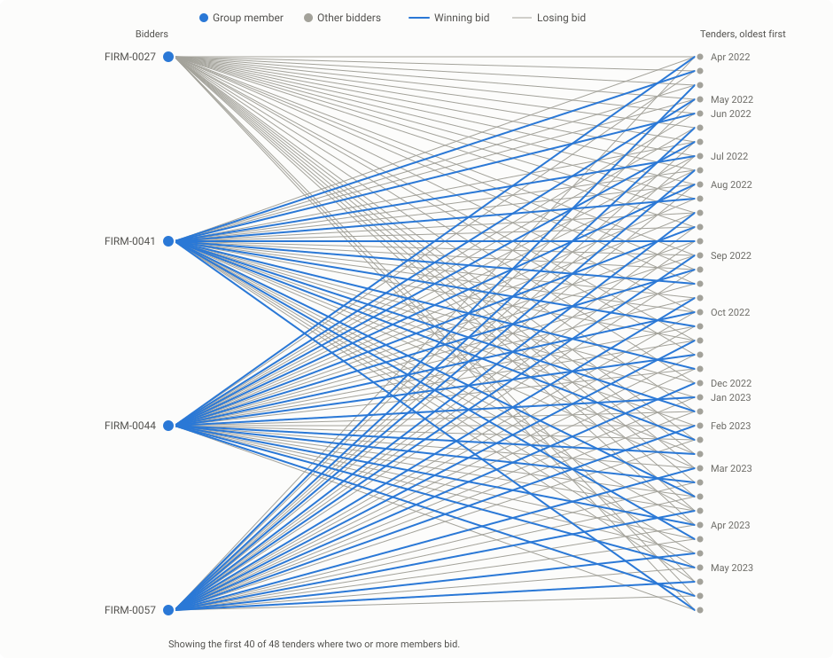
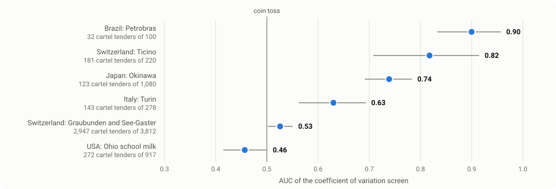
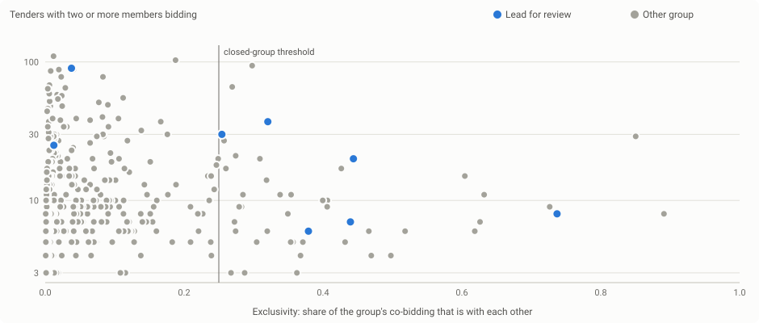
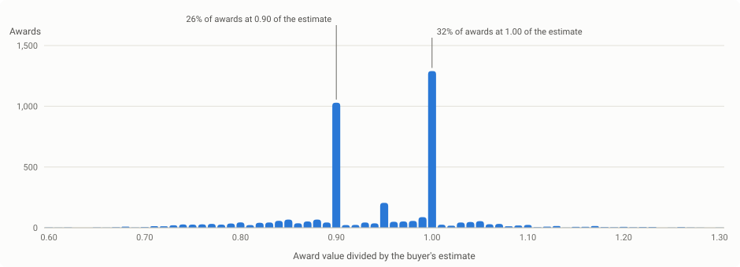
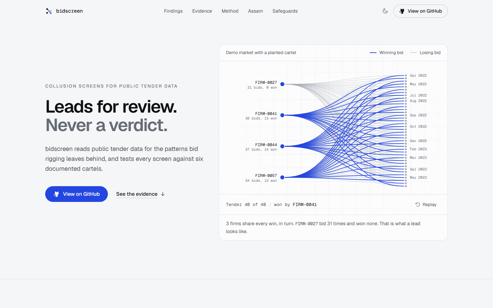

# Procurement fraud pattern detector

Collusion screens for public tender data. The output is a list of **leads for a person to review**. It never says that fraud was detected, and it never names a company.

**Project site:** [anubhavdey0.github.io/procurement-fraud-pattern-detector](https://anubhavdey0.github.io/procurement-fraud-pattern-detector/), an interactive tour of the method, the evidence and the Assam leads.

<picture>
  <source media="(prefers-color-scheme: dark)" srcset="docs/figures/demo-lead-dark.svg">
  
</picture>

*One lead from the built-in demo market, where a cartel is planted on purpose. Three firms take turns winning and the fourth only ever files losing bids. Every name is replaced by a label.*

## What this project does

1. Builds the **firm-tender bipartite graph** from public tender data: a bid is a link between a firm and a tender.
2. Applies **screens from the bid-rigging literature** (variance, relative distance, co-bidding groups, bid rotation, cover bidding) and does not invent detectors of its own.
3. **Checks every screen against six documented cartel cases** and reports where each one works and where it fails.
4. Applies the screens that the data supports to about 10,000 tenders from **Assam, India**, and writes an anonymised report.

The package is called `bidscreen`. The repository keeps its working title.

## What came out of it

Three findings, in order of how much weight they can bear.

**1. Price screens work, where every bid amount is published.** On tenders from six documented cartels, the variance screen ranks cartel tenders above competitive ones in four cases and fails in two. No screen works everywhere.

**2. Who bids with whom does not, on its own, find cartels.** A co-bidding network singled out the cartel pairs in one case of four. Leads built only from participation and outcomes found none of the documented cartels.

**3. Indian open tender data supports only the weaker kind of screen.** The Assam data lists bidders and awards but not losing bid amounts. The screen there produces 8 leads from 335 co-bidding groups. Given finding 2, they are a reading list and nothing more.

That third point is the most useful result here: the best-tested screens cannot run on this data, because the amounts of the losing bids are not in it.

## Quick start

No download is needed for the demo. It runs every screen on a synthetic market with a planted cartel and writes a report.

```bash
git clone https://github.com/anubhavdey0/procurement-fraud-pattern-detector.git
cd procurement-fraud-pattern-detector
python -m venv .venv
.venv\Scripts\activate          # Windows. On macOS or Linux: source .venv/bin/activate
pip install -e ".[dev]"

bidscreen demo                  # writes out/demo/report.html
pytest                          # 95 tests, about two minutes (6 need the downloaded data)
```

To reproduce the real results:

```bash
bidscreen fetch                 # downloads the public files (about 30 MB), checks their SHA-256
bidscreen validate              # scores every screen on the six cartel cases (about 5 minutes)
bidscreen screen assam          # screens the Assam tenders, writes out/assam/report.html
```

Python 3.10 or later. The sample report from the Assam run is in [docs/sample/assam-report.html](docs/sample/assam-report.html), and the [project site](https://anubhavdey0.github.io/procurement-fraud-pattern-detector/report/assam.html) serves it directly.

## How it works

```
public tender data
      |
      v
two tables: tenders, bids          one loader per source
      |
      v
firm-tender bipartite graph
      |
      v
co-bidding links                   pairs that bid together more than chance allows
      |
      v
groups of firms                    grown on those links
      |
      v
four screens per group             closed group, rotation, cover bidding, award price
      |
      v
leads for review                   groups where two or more screens fired
      |
      v
anonymised report                  labels for names, refused if a real name slips through
```

Where every bid amount is published, seven price screens also run on each tender.

| Screen | Asks | Needs | Source |
|---|---|---|---|
| Coefficient of variation, spread | Are the bids packed unusually close together? | every bid amount | Abrantes-Metz et al. (2006) |
| Relative distance, gap between two lowest | Is the lowest bid set apart from the rest? | every bid amount | Imhof, Karagok and Rutz (2018) |
| Skewness, kurtosis, Kolmogorov-Smirnov | Is the shape of the bid distribution lopsided or bunched? | every bid amount | Huber and Imhof (2019) |
| Closed group | Is a group's bidding mostly with itself, beyond what reshuffled markets give? | who bid on what | Wachs and Kertesz (2019) |
| Winner rotation | Do members take turns winning more often than chance? | winners, in time order | runs test (Mood 1940); pattern from the OECD guidelines (2009) |
| Persistent losing bidder | Does a member keep bidding and keep losing? | winners | OECD guidelines (2009); Toth et al. (2014) |
| Awards near the estimate | Are the group's awards closer to the estimate than other tenders from the same buyers? | award value and estimate | Wachs and Kertesz (2019) |

Formulas, null models and thresholds are in [docs/methodology.md](docs/methodology.md). Where the implementation differs from a paper, the difference is listed there.

## Checked against documented cartels

The ground truth is six sets of tenders in which a competition authority or a court identified a cartel, assembled by Garcia Rodriguez et al. (2022). Each has every bid, with the cartel's tenders flagged.

The number is the AUC: the chance that a randomly chosen cartel tender ranks above a randomly chosen competitive one. **0.5 is a coin toss. Below 0.5 the screen points the wrong way.**

| Screen | Brazil: Petrobras | Switzerland: Ticino | Japan: Okinawa | Italy: Turin | Switzerland: Graubunden, See-Gaster | USA: Ohio school milk |
|---|---:|---:|---:|---:|---:|---:|
| Coefficient of variation | **0.90** | **0.82** | **0.74** | 0.63 | 0.53 | 0.46 |
| Spread | **0.90** | **0.79** | **0.72** | 0.68 | 0.49 | 0.45 |
| Relative distance | **0.76** | 0.68 | 0.62 | 0.52 | 0.42 | 0.50 |
| Skewness | **0.72** | **0.82** | 0.59 | 0.58 | 0.46 | 0.51 |
| Kurtosis | 0.49 | 0.69 | 0.56 | 0.40 | 0.47 | 0.45 |
| Kolmogorov-Smirnov distance | 0.58 | **0.71** | 0.51 | 0.46 | 0.41 | 0.45 |
| Gap between two lowest bids | 0.38 | 0.55 | 0.43 | 0.48 | 0.43 | 0.53 |
| All seven averaged | **0.80** | **0.86** | 0.66 | 0.57 | 0.43 | 0.46 |
| Cartel tenders / tenders scored | 32 / 100 | 181 / 220 | 123 / 1,080 | 143 / 278 | 2,947 / 3,812 | 272 / 917 |

Bold marks 0.70 or more. Tenders need three or more bids to be scored.

<picture>
  <source media="(prefers-color-scheme: dark)" srcset="docs/figures/validation-dark.svg">
  
</picture>

What the table says:

- **The variance screen is the workhorse.** Cover bids sit close together, so bids on a rigged tender vary less. It reaches 0.74 to 0.90 in three cases.
- **Two cases defeat every screen.** In the Graubunden and See-Gaster set, cartel members bid alongside outsiders in about 40% of tenders, and an outsider's bid breaks the tight pattern. In the Ohio set most tenders have two bidders, so there is almost no distribution to measure.
- **Averaging the screens does not beat the best one.** The weak screens dilute the strong ones.
- **A fixed rule does not transfer.** "Variance below 0.06 and relative distance above 1", the benchmark of Imhof, Karagok and Rutz, is right 98% of the time on Ticino and 82% on Petrobras, and no better than a random pick on three other cases.

### The network screens, checked the same way

In the four cases that identify bidders, does bidding together single out pairs of cartel members?

| Case | Cartel pairs | AUC of excess co-bidding |
|---|---:|---:|
| USA: Ohio school milk | 3 | 1.00 |
| Japan: Okinawa | 5,124 | 0.52 |
| Italy: Turin | 3,256 | 0.42 |
| Brazil: Petrobras | 102 | 0.38 |

And do the leads from the full group method land on cartel tenders?

| Case | Leads | Tenders flagged | Of which cartel tenders | Share of all tenders that are cartel tenders |
|---|---:|---:|---:|---:|
| Japan: Okinawa | 1 | 43 | 0% | 11% |
| USA: Ohio school milk | 3 | 319 | 3% | 13% |
| Brazil: Petrobras | 0 | 0 | | 33% |
| Italy: Turin | 0 | 0 | | 51% |

**They do not.** Who bids with whom reflects how a market is organised: which contractors are local, which are eligible, whom the buyer invites. Ohio shows both halves of this. The three cartel dairies are the three most closely linked pairs in that market, so the graph does point at them. But the group they sit in did not stand out on any outcome screen, and the leads that did form were elsewhere. The group method marks places where collusion would be easy to sustain. It does not mark places where it happened.

This is the reason the Assam output is framed the way it is.

## The Assam run

Source: [Assam Public Procurement Data](https://github.com/CivicDataLab/assam-tenders-data), published by CivicDataLab under the Open Database License. 43,669 tenders from fiscal years 2016-17 to 2022-23.

| | |
|---|---:|
| Tenders that list who bid | 9,994 |
| Distinct bidders (matched by name) | 12,213 |
| Pairs of bidders that ever bid together | 2,497,449 |
| Pairs linked: three or more joint tenders, and more than chance | 22,070 |
| Co-bidding groups found | 335 |
| Groups where the closed-group screen fired | 46 |
| Groups where the award-price screen fired | 17 |
| Groups where the cover-bidding screen fired | 11 |
| Groups where the rotation screen fired | 0 of 62 tested |
| **Leads: two or more screens** | **8** |

<picture>
  <source media="(prefers-color-scheme: dark)" srcset="docs/figures/groups-dark.svg">
  
</picture>

Each dot is a group of firms that bid together far more than their activity explains. Most are what a local market looks like. The eight highlighted groups are the leads.

One finding does not depend on any screen. Award prices in this data pile up at two values:

<picture>
  <source media="(prefers-color-scheme: dark)" srcset="docs/figures/award-price-dark.svg">
  
</picture>

26% of awards are at 0.90 of the buyer's estimate and 32% are at 1.00, to the nearest 0.01. Piles like these usually come from rules, such as a floor below which a bid is treated as abnormally low. They are a property of the market, and a screen that read the price level on its own would flag half of it. The price screen here compares each group only with other tenders from the same buyer and postal region.

## What this project will not do

A screen that publicly attached company names to the word "fraud" would be reckless, and wrong most of the time. So:

- **No names leave the tool.** Firms, tenders and buyers appear as `FIRM-00042`, `TENDER-00317`, `BUYER-0012`. Labels are derived with a keyed hash. The key stays in `data/private/`, which git ignores.
- **The report refuses to be written if a real name is in it.** The finished page is searched for every real identifier before it is saved. A test proves the refusal works.
- **The data is not redistributed.** Raw files hold real names of firms and of individual contractors. They are downloaded by the user, pinned to a commit and checked against a SHA-256 digest.
- **Every lead lists what to rule out first.** A small local market, a specialised trade, a stale estimate, a rule that piles bids at a floor.
- **Bidders are matched by name.** Two people who share a name are merged. A renamed firm is split. Nothing here should be acted on without going back to the tender records.

More in [docs/responsible-use.md](docs/responsible-use.md).

## Limits

- The validation is descriptive and in-sample, on six cases. It shows where a screen has carried signal. It does not promise the next market.
- The group method differs from Wachs and Kertesz (2019) in three stated ways, and its thresholds are judgement calls. Change them with command-line flags.
- The Assam bidder lists cover mostly 2021-22 and 2022-23, and the number of bidders listed matches the number the portal reports for under half of the tenders.
- No estimate of how many leads are false is possible on the Assam data, because there is no ground truth for it.

The single change that would matter most: the amount of every losing bid. With those, the screens in the first table apply directly.

## Project site

<a href="https://anubhavdey0.github.io/procurement-fraud-pattern-detector/"></a>

The site in [`site/`](site/) is built with React, Vite, Tailwind and Motion, and published to GitHub Pages by [`.github/workflows/site.yml`](.github/workflows/site.yml) on every push that touches it. It reads one file, `site/src/data/site-data.json`, which holds the same content as the HTML report: labels only, dates to the month. The file is written by

```bash
bidscreen export-site           # runs the Assam screen and writes site/src/data/site-data.json
```

and is put through the same leak check as the report, so it is not written if a real name is in it. To work on the site locally:

```bash
cd site
npm ci
npm run dev                     # http://localhost:5173
```

## Project layout

```
src/bidscreen/
  model.py            the two tables every loader produces
  ingest/             loaders: Assam OCDS package, six cartel cases, pinned downloads
  names.py            conservative supplier-name matching
  anonymize.py        keyed labels and the leak check
  graph.py            bipartite graph, co-bidding links, groups, reshuffle null model
  screens/            price, rotation, cover, award-price screens
  leads.py            runs the screens and assembles leads
  validate.py         scores screens against the documented cases
  charts.py           SVG charts with no plotting dependency
  report.py           the HTML report
  sitedata.py         the data file the project site reads
  synthetic.py        demo market with a planted cartel
  cli.py              the bidscreen command
tests/                95 tests, including hand-worked values for every statistic
docs/                 methodology, data sources, responsible use, sample output
site/                 the project site
```

## Data and licences

| Source | Used for | Licence |
|---|---|---|
| [CivicDataLab, Assam Public Procurement Data](https://github.com/CivicDataLab/assam-tenders-data) | the Assam run | Open Database License (ODbL) |
| Garcia Rodriguez et al. (2022), six collusion datasets | validation | published with the paper; not redistributed here |

Figures and the sample report in `docs/` contain information from the Assam Public Procurement Data, made available by CivicDataLab under the ODbL. Details in [docs/data-sources.md](docs/data-sources.md).

The code is under the MIT licence. See [LICENSE](LICENSE).

## References

- Abrantes-Metz, Froeb, Geweke and Taylor (2006). A variance screen for collusion. *International Journal of Industrial Organization* 24(3).
- Garcia Rodriguez, Rodriguez-Montequin, Ballesteros-Perez, Love and Signor (2022). Collusion detection in public procurement auctions with machine learning algorithms. *Automation in Construction* 133, 104047.
- Huber and Imhof (2019). Machine learning with screens for detecting bid-rigging cartels. *International Journal of Industrial Organization* 65.
- Imhof, Karagok and Rutz (2018). Screening for bid rigging: does it work? *Journal of Competition Law and Economics* 14(2).
- Lancichinetti, Fortunato and Kertesz (2009). Detecting the overlapping and hierarchical community structure in complex networks. *New Journal of Physics* 11.
- OECD (2009). Guidelines for fighting bid rigging in public procurement.
- Onnela, Saramaki, Kertesz and Kaski (2005). Intensity and coherence of motifs in weighted complex networks. *Physical Review E* 71.
- Toth, Fazekas, Czibik and Toth (2014). Toolkit for detecting collusive bidding in public procurement. Corruption Research Center Budapest.
- Wachs and Kertesz (2019). A network approach to cartel detection in public auction markets. *Scientific Reports* 9, 10818.
